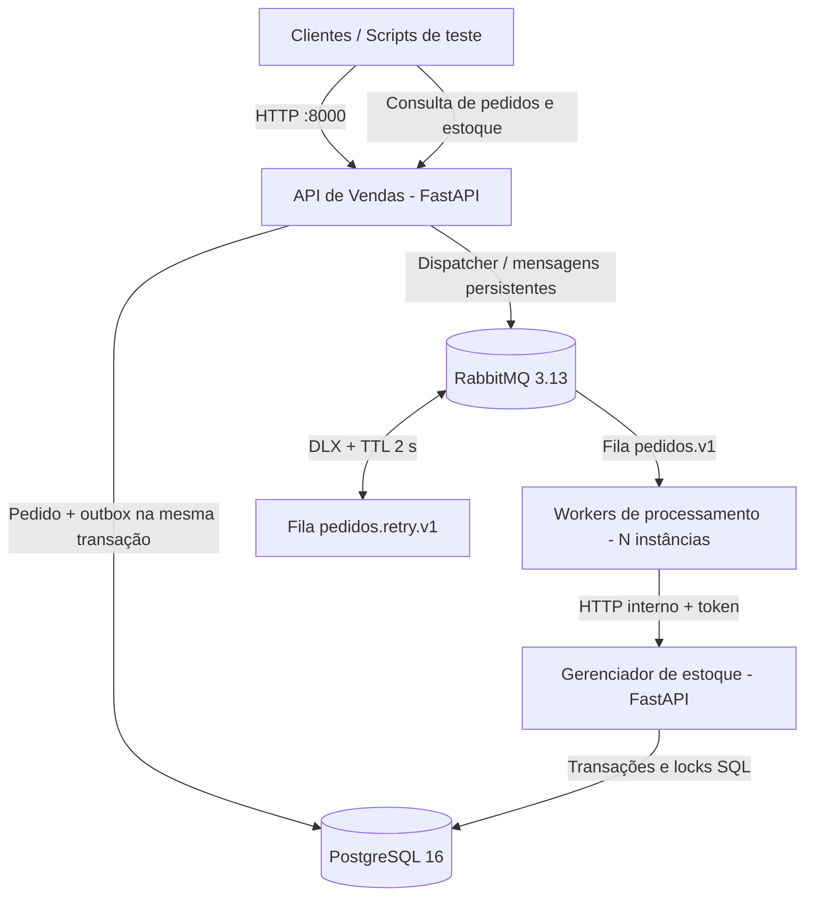

# Sistema Distribuído de Venda de Ingressos — FCCPD

Projeto da disciplina **Fundamentos de Computação Concorrente, Paralela e Distribuída (FCCPD)**, da **CESAR School**. O sistema simula reservas e compras de ingressos de um show com setor `pista` e estoque inicial de **50 unidades**. Esta documentação descreve a **Entrega 2**, baseada nos arquivos efetivamente presentes nesta versão do projeto.

**Equipe:** Felipe Menelau, Fátima Beatriz, Tomás de Aquino e Vitória Silva (nomes apresentados no README anterior).

Documentação complementar citada pela equipe: [pasta de arquitetura e uso de IA no Google Drive](https://drive.google.com/drive/folders/1AGvT_I1axotGDDgVN57LAH5KPqU83lJ7?usp=sharing).

## 1. Visão geral

A API recebe pedidos HTTP de **reserva** e **confirmação** e os grava no PostgreSQL, junto com registros da *transactional outbox*. Um dispatcher publica os identificadores dos pedidos no RabbitMQ. Um ou mais workers consomem as mensagens, invocam os endpoints internos do gerenciador de estoque e confirmam a mensagem com `ack` **após** o resultado ter sido persistido. O PostgreSQL aplica transações e restrições que impedem estoque negativo ou vendas além do limite.

O pagamento é **simulado e aprovado** no worker; **não** existe integração com gateway financeiro real.

### Arquitetura



| Serviço | Responsabilidade |
|---|---|
| `api-vendas` | Endpoints públicos; grava `pedidos` e `outbox` atomicamente; dispatcher publica no broker e registra `publicado_em` após confirmação. |
| `rabbitmq` | Filas duráveis `pedidos.v1` e `pedidos.retry.v1`; entrega assíncrona e reentregas por fila de retry. |
| `worker-processador` | Consome mensagens com `prefetch_count=1`, executa operações pelo serviço interno e emite `ack` após persistência. |
| `gerenciador-estoque` | Reserva, preparação e finalização da compra; expiração de reservas; idempotência de processamento baseada no estado do pedido. |
| `db` | PostgreSQL com tabelas `estoque`, `reservas`, `pedidos` e `outbox`; aplica a invariante de estoque. |

**Consistência:** `inicial = disponivel + reservado + vendido`, com `CHECK` no banco. Reservas e vendas usam transações SQL; a conclusão dos pedidos é **eventual**, devido ao consumo assíncrono. A seleção da outbox utiliza `FOR UPDATE SKIP LOCKED`. As requisições públicas admitem `Idempotency-Key` para evitar criar pedidos distintos com a mesma chave e conteúdo.

**Reserva:** expira após `RESERVATION_TTL_SECONDS` (padrão: 180 s), quando ainda está em `em_reserva`; o reaper a devolve ao estoque. Uma reserva no estado `confirmando` não é expirada por essa rotina.

## 2. Requisitos

- Docker Desktop com Docker Compose.
- Python **3.10+** no computador para executar os scripts de teste; no Windows, usar `py` caso `python` não esteja no PATH.
- Portas disponíveis: **8000** (API) e **15672** (console RabbitMQ, vinculado a `127.0.0.1`).
- Arquivo `.env` com credenciais de laboratório. **Não versionar `.env` nem utilizar credenciais padrão em produção.**

## 3. Execução no Windows / PowerShell

Abra o terminal na pasta que contém `docker-compose.yml`:

```powershell
# Apenas se ainda não houver arquivo .env:
Copy-Item .env.example .env

docker compose up --build -d --scale worker-processador=2
docker compose ps
```

Endereços úteis:

- **API interativa:** http://localhost:8000/docs
- **Estoque:** http://localhost:8000/estoque
- **Saúde da API:** http://localhost:8000/health
- **RabbitMQ:** http://localhost:15672 (credenciais `RABBITMQ_USER` e `RABBITMQ_PASSWORD` do `.env`)

Verificar erros:

```powershell
docker compose logs --tail 100 api-vendas worker-processador gerenciador-estoque
```

Parar mantendo os volumes:

```powershell
docker compose down
```

**Cuidado:** `docker compose down -v` apaga os volumes de PostgreSQL e RabbitMQ, eliminando os dados locais de testes e mensagens ainda guardadas.

### Compra manual

A API retorna HTTP `202 Accepted` ao criar o pedido; isso **não significa que a compra já foi concluída**.

1. Em `/docs`, execute `POST /reservar` com `{"cliente":"Ana","setor":"pista","quantidade":1}`.
2. Copie o `pedido_id` e consulte `GET /pedidos/{pedido_id}` até `status = concluido`.
3. Do campo `resultado`, copie `reserva_id`.
4. Execute `POST /confirmar` com `{"reserva_id":"UUID_COPIADO"}`.
5. Consulte o **novo** `pedido_id` até `concluido` e confirme `resultado.estado = vendido`.
6. Confira `GET /estoque`: uma compra de uma unidade reduz `disponivel` para 49 e aumenta `vendido` para 1.

## 4. Estrutura do projeto

```text
projeto-ingresso-distribuido/
├── api-vendas/
│   ├── app.py                 # API HTTP + dispatcher da outbox
│   ├── Dockerfile
│   └── requirements.txt
├── gerenciador-estoque/
│   ├── estoque.py             # Regras de reserva, confirmação e expiração
│   ├── Dockerfile
│   └── requirements.txt
├── worker-processador/
│   ├── worker.py              # Consumidor RabbitMQ
│   ├── geracao_ingressos.py   # Benchmark real de geração de QR Codes
│   ├── Dockerfile
│   └── requirements.txt
├── shared/
│   ├── db.py                 # Conexão com PostgreSQL
│   ├── rabbit.py             # Conexão e declaração das filas
│   ├── schema.sql            # Tabelas, restrições e estoque inicial
│   └── __init__.py
├── testes/
│   ├── teste_concorrencia.py  # Clientes simultâneos, reservas e vendas
│   ├── benchmark.py          # Medição HTTP, append em CSV
│   ├── benchmark_paralelo.py # SHA-256 sintético seq. vs. paralelo
│   ├── teste_paralelismo.py  # Teste unitário de SHA-256
│   ├── teste_falhas.py       # Retomada de pedidos após parada de workers
│   ├── resultados_http.csv   # Medições registradas na cópia enviada
│   └── pedidos_falha.json    # IDs gravados pelo ensaio de falhas
├── resultados/                # Evidências textuais e logs dos testes
├── saidas/                    # QR Codes seq/par e benchmark_qr.json
├── docker-compose.yml
├── .env.example
├── INICIO_RAPIDO_WINDOWS.md  # Guia auxiliar; seção de duas máquinas é legada
└── README.md
```

Os Dockerfiles copiam os módulos de serviço para `/app/service`; por isso alguns comandos **dentro do container** usam `service/geracao_ingressos.py`, embora o arquivo no host esteja em `worker-processador/geracao_ingressos.py`.

## 5. Testes reproduzíveis

**Atenção:** as instruções com `down -v` devem ser utilizadas **somente em ambiente de testes**, após salvar as evidências. Para comparar cenários, é necessário começar com o mesmo estoque de 50 ingressos.

### 5.1 Concorrência e consistência

```powershell
docker compose down -v
docker compose up -d --scale worker-processador=2
py -u .\testes\teste_concorrencia.py --clientes 100
```

Resultado esperado no cenário padrão: **50 vendidos, 50 `sem_estoque`, `invariante_ok: true`**. A carga usa 24 threads de clientes por padrão e um fluxo completo de reserva + confirmação para cada compra aceita.

Verificar pendências de publicação:

```powershell
docker compose exec db psql -U ingressos -d ingressos -c "SELECT COUNT(*) AS pendentes FROM outbox WHERE publicado_em IS NULL;"
```

O resultado observado após a execução validada foi **zero** pendências.

### 5.2 Benchmark HTTP com 1, 2 e 4 workers

Repita **cinco vezes para cada cenário**, reinicializando o banco entre as execuções. Exemplo com **2 workers**:

```powershell
docker compose down -v
docker compose up -d --scale worker-processador=2
py -u .\testes\benchmark.py --clientes 100 --workers 2
```

Troque **tanto** `--scale worker-processador=N` **quanto** `--workers N` para `1` ou `4`. O parâmetro `--workers` do script é **somente um rótulo** no CSV; ele não configura os containers. O script adiciona uma linha a `testes/resultados_http.csv`.

**Medições da cópia enviada (primeiras cinco de cada cenário):**

| Workers | Tempos das 5 execuções (s) | Mediana (s) | Vazão calculada (clientes/s) | Speedup vs. 1 worker |
|---|---|---:|---:|---:|
| 1 | 8,582 · 7,825 · 7,819 · 8,328 · 10,138 | 8,328 | 12,01 | 1,00× |
| 2 | 4,924 · 4,895 · 4,836 · 5,239 · 4,826 | 4,895 | 20,43 | 1,70× |
| 4 | 3,647 · 3,482 · 3,709 · 3,861 · 3,527 | 3,647 | 27,42 | 2,28× |

**Vazão:** `100 / mediana do tempo`, em **clientes/s**, porque cada cliente executa um fluxo de compra. No CSV, a coluna histórica `vazao_pedidos_s` usa a mesma fórmula; o nome do campo **não corresponde necessariamente ao número de mensagens internas/s**. Existe uma sexta linha adicional para 2 workers no CSV enviado (4,779 s), não incluída na comparação padronizada de cinco repetições.

### 5.3 Paralelismo real: geração de QR Codes

Após realizar **50 vendas**, execute:

```powershell
docker compose run --rm worker-processador python service/geracao_ingressos.py --processos 4 --repeticoes 5
```

O script consulta as **vendas reais persistidas** em `reservas`, gera os mesmos PNGs sequencialmente e com `ProcessPoolExecutor`, compara os hashes SHA-256 dos arquivos e grava:

- `saidas/seq/` — imagens sequenciais;
- `saidas/par/` — imagens paralelas;
- `saidas/benchmark_qr.json` — medianas e speedup.

**Resultado presente no ZIP:** 50 ingressos, cinco repetições, quatro processos, mediana sequencial **3,5166 s**, mediana paralela **1,1981 s**, **speedup 2,935×** (~65,9% menos tempo).

### 5.4 Paralelismo sintético: SHA-256

```powershell
py -u .\testes\benchmark_paralelo.py --lotes 24 --iteracoes 50000 --processos 4 --repeticoes 5
```

Compara lotes **fictícios e determinísticos**, validando a igualdade dos hashes. Salva `testes/resultados_paralelo.csv`. **Não há resultados desse teste na cópia enviada**, portanto nenhuma medição foi atribuída a ele.

### 5.5 Recuperação após indisponibilidade dos consumidores

Com **estoque limpo** e dois workers configurados:

```powershell
docker compose stop worker-processador
py -u .\testes\teste_falhas.py --criar 10
# Opcional: observe as mensagens em http://localhost:15672
docker compose start worker-processador
py -u .\testes\teste_falhas.py --verificar
```

**Resultado registrado:** dez reservas processadas após o retorno dos workers; estoque final com **40 disponíveis, 10 reservados e 0 vendidos**, `invariante_ok: true`.

### 5.6 Continuidade com falha de um consumidor

Com dois workers, estoque limpo e a carga de 100 clientes em andamento, interrompa **um** deles em outro terminal:

```powershell
docker compose ps -a
docker kill ingressos-worker-processador-1
```

O nome do container pode variar; confira antes com `docker compose ps -a`. Ao final, verifique `/estoque` e os logs. No experimento registrado, o worker interrompido apareceu como `Exited (137)`, o outro permaneceu ativo e o ensaio terminou em **7,617 s**, com **50 vendas, 50 sem estoque e invariante preservada**.

**Limites da comprovação:** os resultados demonstram recuperação após indisponibilidade e continuidade com consumidor interrompido, **mas não comprovam diretamente a reentrega de uma mensagem recebida e não confirmada antes do `ack`**. A arquitetura do compose também **não oferece failover automático de PostgreSQL ou RabbitMQ**.

## 6. Operação, segurança e limitações

- **Não há pagamento financeiro real:** o worker simula a aprovação de pagamentos.
- **Não há reserva de assentos numerados:** o estoque é por setor e quantidade.
- **Não há deploy distribuído entre duas máquinas nesta versão:** o arquivo `docker-compose.yml` executa serviços em containers de uma mesma máquina. As referências a `compose.servidor.yml`, `compose.worker.yml` e `compose.misto.yml` no guia auxiliar **não correspondem a arquivos presentes neste ZIP**.
- **Credenciais de laboratório:** altere senhas e `INTERNAL_TOKEN` antes de qualquer exposição a outra rede.
- **Banco e broker como pontos únicos de falha:** o compose não configura replicação ou failover.
- **Tentativas posteriores:** o RabbitMQ usa uma fila de retry durável com TTL de 2 segundos; o código não demonstra um limite efetivamente aplicado de tentativas nem uma fila de quarentena final, embora defina `MAX_RETRIES` no worker.
- **Validade de reserva:** padrão de 180 segundos; expiradas antes da confirmação retornam ao estoque.
- **Observabilidade:** consulte `docker compose logs`, a API, a página RabbitMQ e os artefatos em `resultados/`.

## 7. Evidências e uso de IA

A cópia enviada inclui `testes/resultados_http.csv`, `saidas/benchmark_qr.json`, imagens PNG e arquivos de log em `resultados/`. A descrição do apoio do ChatGPT na **depuração dos testes, correções de código e atualização documental** encontra-se no arquivo complementar **`log_uso_ia.md`** (disponibilizado separadamente nesta atualização).
